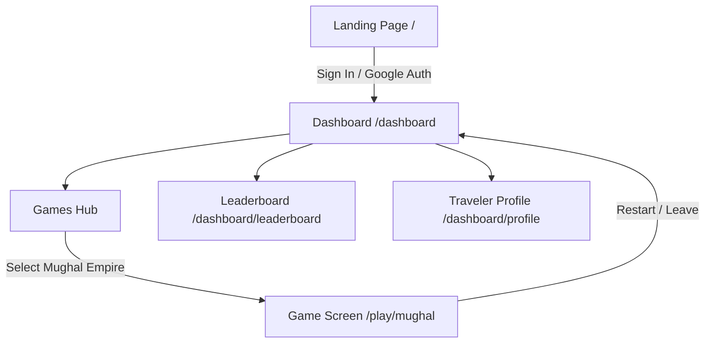
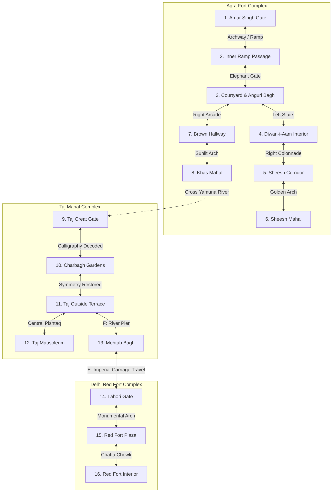

# 🏛️ Bharat Gatha (भारत गाथा) — Comprehensive Technical & Architectural Documentation

> **"An AI Story You Play — Step into history. Live the legend."**  
> *A Smart India Hackathon (SIH) Interactive Historical Adventure & Educational RPG Platform.*

---

## 📋 Table of Contents
1. [Executive Summary & Project Vision](#1-executive-summary--project-vision)
2. [System Architecture & Technology Stack](#2-system-architecture--technology-stack)
3. [Repository & Directory Structure](#3-repository--directory-structure)
4. [Design System & Visual Language](#4-design-system--visual-language)
5. [Core Modules & Application Flow](#5-core-modules--application-flow)
   - [5.1 Landing & Authentication Portal (`/`)](#51-landing--authentication-portal-)
   - [5.2 Traveler Dashboard & Campaign Hub (`/dashboard`)](#52-traveler-dashboard--campaign-hub-dashboard)
   - [5.3 Global Leaderboard & Ranking (`/dashboard/leaderboard`)](#53-global-leaderboard--ranking-dashboardleaderboard)
   - [5.4 Traveler Profile & Statistics (`/dashboard/profile`)](#54-traveler-profile--statistics-dashboardprofile)
6. [Interactive RPG Game Engine Deep Dive (`/play/mughal`)](#6-interactive-rpg-game-engine-deep-dive-playmughal)
   - [6.1 Continuous 60 FPS Game Loop & Input System](#61-continuous-60-fps-game-loop--input-system)
   - [6.2 Perspective Depth Scaling & 2.5D Kinematics](#62-perspective-depth-scaling--25d-kinematics)
   - [6.3 Collision Detection & Spatial Geometry Boundaries](#63-collision-detection--spatial-geometry-boundaries)
   - [6.4 Scene State Machine & Traversal Graph](#64-scene-state-machine--traversal-graph)
   - [6.5 Interactive Puzzles & Historical Discovery Mechanics](#65-interactive-puzzles--historical-discovery-mechanics)
   - [6.6 NPC Dialogue & Archaeological Lore Engine](#66-npc-dialogue--archaeological-lore-engine)
   - [6.7 Dynamic Inter-City Travel & Audio Subsystem](#67-dynamic-inter-city-travel--audio-subsystem)
   - [6.8 State Persistence, URL Synchronization & Save Subsystem](#68-state-persistence-url-synchronization--save-subsystem)
   - [6.9 Dynamic HUD, Minimap & Quest Tracking](#69-dynamic-hud-minimap--quest-tracking)
7. [Comprehensive Scene-by-Scene Breakdown](#7-comprehensive-scene-by-scene-breakdown)
8. [Asset Catalog & Media Inventory](#8-asset-catalog--media-inventory)
9. [Developer Guide, Setup & Deployment](#9-developer-guide-setup--deployment)
10. [Future Roadmap & Hackathon Next Steps](#10-future-roadmap--hackathon-next-steps)

---

## 1. Executive Summary & Project Vision

**Bharat Gatha** is an immersive, interactive, image-first educational web game designed to bring Indian history to life through gamified exploration, historical puzzles, authentic architectural reconstructions, and narrative-driven quests.

### Key Objectives
* **Cultural & Historical Preservation:** Enable players to explore authentic architectural monuments of India (such as Agra Fort, Taj Mahal, Mehtab Bagh, and Delhi Red Fort) through pixel-art aesthetic scenes.
* **Interactive Pedagogy:** Replace static textbook memorization with hands-on discovery (e.g., deciphering Persian calligraphy on the Darwaza-i-Rauza, balancing Charbagh water symmetry, discovering authentic crypt facts, and debunking historical myths like the *Black Taj*).
* **High-Performance Gamification:** Deliver 60 FPS in-browser continuous movement, smooth 2.5D perspective scaling, spatial collision geometry, adaptive HUD, dynamic minimaps, and ambient soundscapes without heavy 3D engine overhead.

---

## 2. System Architecture & Technology Stack

```
+-------------------------------------------------------------------------------+
|                                BHARAT GATHA                                  |
+-------------------------------------------------------------------------------+
|                                                                               |
|  +---------------------------+  +----------------------+  +----------------+  |
|  |     Next.js 16 (App Router)|  |    React 19 Engine   |  | TypeScript 5   |  |
|  | - Server & Client Layouts |  | - State Management   |  | - Strict Types |  |
|  | - Webpack Build Engine    |  | - requestAnimationFrame| - Safety Checks |  |
|  +---------------------------+  +----------------------+  +----------------+  |
|                                                                               |
|  +---------------------------+  +----------------------+  +----------------+  |
|  |      Tailwind CSS v4      |  |   HTML5 Web Audio    |  | Storage & Sync |  |
|  | - Theme Variables         |  | - Horse Sound FX     |  | - localStorage |  |
|  | - Neo-Brutalism Tokens    |  | - Dynamic Volume     |  | - URL Search   |  |
|  +---------------------------+  +----------------------+  +----------------+  |
|                                                                               |
+-------------------------------------------------------------------------------+
```

### Core Technologies
* **Framework:** [Next.js 16.3.3](https://nextjs.org/) using the App Router (`app/` directory paradigm) with webpack compilation.
* **UI Library:** [React 19.2.8](https://react.dev/) utilizing functional components, custom hooks, and concurrent features.
* **Type System:** [TypeScript 5](https://www.typescriptlang.org/) for robust interface contracts, scene unions, and coordinate typing.
* **Styling & Design System:** [Tailwind CSS v4](https://tailwindcss.com/) with PostCSS integration (`@tailwindcss/postcss`), inline themes, and custom Neo-Brutalist shadow tokens.
* **Audio Engine:** HTML5 Audio API for ambient carriage locomotion and sound effects.
* **State Persistence:** Hybrid Web Storage (`localStorage`) and browser History API query parameter synchronization.

---

## 3. Repository & Directory Structure

```
Bharat-Gatha-/
├── frontend/
│   ├── app/
│   │   ├── dashboard/
│   │   │   ├── leaderboard/
│   │   │   │   └── page.tsx           # Global leaderboard & player rankings
│   │   │   ├── profile/
│   │   │   │   └── page.tsx           # Traveler stats, level progression & history
│   │   │   ├── ClientLayout.tsx       # Sidebar navigation, theme toggler, shell
│   │   │   ├── ThemeContext.tsx       # React context for Light/Dark mode state
│   │   │   ├── layout.tsx             # Theme-wrapped dashboard layout
│   │   │   └── page.tsx               # Campaign selection hub (Mughal, Rajputana, etc.)
│   │   ├── play/
│   │   │   ├── mughal/
│   │   │   │   └── page.tsx           # 16-scene Mughal RPG engine, collision & puzzles
│   │   │   └── rajasthan/
│   │   │       └── page.tsx           # 5-scene Great Rajputana RPG engine, fort defenses & puzzles
│   │   ├── favicon.ico
│   │   ├── globals.css                # Tailwind imports, custom variables, font styles
│   │   ├── layout.tsx                 # Root HTML layout with Geist font definition
│   │   └── page.tsx                   # Landing portal with historical era slideshow
│   ├── public/                        # High-resolution pixel art backgrounds & sprites
│   │   ├── bg-agra-fort.jpg           # Amar Singh Gate exterior
│   │   ├── bg-agra-passage.jpg        # Ramp passage to Elephant Gate
│   │   ├── bg-agra-courtyard.jpg      # Diwan-i-Aam courtyard & Anguri Bagh
│   │   ├── bg-agra-interior.jpg       # Throne Hall interior
│   │   ├── bg-agra-sheesh-passage.jpg # Sheesh Mahal marble corridor
│   │   ├── bg-agra-sheesh-mahal.jpg   # Palace of Mirrors interior
│   │   ├── bg-agra-brown-passage.jpg  # Jahangiri Mahal red sandstone hallway
│   │   ├── bg-agra-khas-mahal.jpg     # Shah Jahan's Khas Mahal riverfront
│   │   ├── bg-taj-gate.jpg            # Great Gate (Darwaza-i-Rauza)
│   │   ├── bg-taj-charbagh.jpg        # Four-quadrant garden & lotus pool
│   │   ├── bg-taj-exterior.jpg        # Outside marble terrace & pishtaq arch
│   │   ├── bg-taj-mausoleum.jpg       # Royal Cenotaphs interior chamber
│   │   ├── bg-taj-mehtab-bagh.jpg     # Moonlight Garden (Yamuna crossing)
│   │   ├── bg-red-fort-lahori.jpg     # Lahori Gate monumental entrance
│   │   ├── bg-red-fort-plaza.jpg      # Red Fort inner plaza
│   │   ├── bg-red-fort-interior.jpg   # Chatta Chowk bazaar interior
│   │   ├── player.png                 # Main protagonist pixel sprite
│   │   ├── guard.png                  # Mughal royal sentry sprite
│   │   ├── npc-archaeologist.png      # Mehtab Bagh caretaker archaeologist sprite
│   │   ├── carriage2_transparent.png  # Imperial horse carriage sprite
│   │   └── horse_sound.webm           # Audio loop for inter-city carriage travel
│   ├── package.json
│   ├── tsconfig.json
│   ├── next.config.ts
│   ├── postcss.config.mjs
│   └── eslint.config.mjs
└── DOCUMENTATION.md                   # This comprehensive documentation
```

---

## 4. Design System & Visual Language

Bharat Gatha fuses **Indian Historical Monumental Art** with **Modern Neo-Brutalism**:

### Aesthetic Principles
1. **Neo-Brutalist HUD & Modals:**
   - Bold 2px–3px pure black borders (`border-2 border-black` / `border-3 border-black`).
   - Hard drop shadows with zero blur (`shadow-[3px_3px_0_0_rgba(0,0,0,1)]`, `shadow-[4px_4px_0_0_rgba(0,0,0,1)]`).
   - Crisp parchment and gold backgrounds (`#fff9ea`, `#fef3c7`, `#f59e0b`).
   - Tactile button press feedback (`active:translate-y-0.5`).
2. **Royal Heritage Color Palette:**
   - **Mughal Gold & Sandstone:** `#91714b`, `#b4986b`, `#e4c794`, `#e2b975`.
   - **Deep Royal Obsidian:** `#050403`, `#0a0806`, `#16202c`.
   - **Imperial Crimson & Ruby:** `#dc2626`, `#991b1b`.
   - **Emerald Water:** `#059669`, `#10b981`.
3. **Adaptive Dark / Light Theming:**
   - Complete toggle support across all dashboard views.
   - Dark mode uses deep obsidian with radial gold light glows.
   - Light mode uses warm royal ivory `#fdfbf7` with subtle gold filigree accents.

---

## 5. Core Modules & Application Flow



### 5.1 Landing & Authentication Portal (`/`)
* **File:** [`frontend/app/page.tsx`](frontend/app/page.tsx)
* **Features:**
  * **Dynamic Era Slideshow:** Cycles smoothly across 4 eras every 6 seconds: Pixel Art Overview (`/bg-pixel.jpg`), Indus Valley (`/bg-indus.jpg`), Mughal Empire (`/bg-mughal.jpg`), and British Era (`/bg-british.jpg`).
  * **Mughal Architectural Arch Card:** Backdrop-blur glassmorphic arch with gold borders, radial light glows, and custom typography.
  * **Authentication Entry Points:** Direct Google OAuth button and Magic Link email sign-up input navigating directly to `/dashboard`.

### 5.2 Traveler Dashboard & Campaign Hub (`/dashboard`)
* **Files:** 
  * [`frontend/app/dashboard/page.tsx`](frontend/app/dashboard/page.tsx)
  * [`frontend/app/dashboard/ClientLayout.tsx`](frontend/app/dashboard/ClientLayout.tsx)
  * [`frontend/app/dashboard/ThemeContext.tsx`](frontend/app/dashboard/ThemeContext.tsx)
* **Features:**
  * **Persistent Sidebar:** Houses the Bharat Gatha emblem, navigation links, dark/light theme switch, and sign-out button.
  * **Campaign Grid:**
    1. **Great Mughal Empire (Agra/Delhi):** Status: *Playable* (`/play/mughal`).
    2. **Great Rajputana (Rajasthan):** Status: *Coming Soon*.
    3. **Great Vijayanagara (Karnataka):** Status: *Coming Soon*.

### 5.3 Global Leaderboard & Ranking (`/dashboard/leaderboard`)
* **File:** [`frontend/app/dashboard/leaderboard/page.tsx`](frontend/app/dashboard/leaderboard/page.tsx)
* **Features:**
  * Top players ranking with historical titles: *Emperor, General, Strategist, Warrior, Noble, Traveler*.
  * Gold (`#1`), Silver (`#2`), and Bronze (`#3`) podium visual badges.
  * Formatted XP scoring system.

### 5.4 Traveler Profile & Statistics (`/dashboard/profile`)
* **File:** [`frontend/app/dashboard/profile/page.tsx`](frontend/app/dashboard/profile/page.tsx)
* **Features:**
  * Player Avatar, Level (Level 42), Title (*Emperor*), Global Rank (#1 Global).
  * XP progress bar with numerical tracker (`14,250 XP`).
  * Analytics grid: *Games Played (108), Win Rate (76%), Highest Score (2,450)*.
  * Adventure history tracker.

---

## 6. Interactive RPG Game Engine Deep Dive (`/play/mughal`)

* **Primary Engine File:** [`frontend/app/play/mughal/page.tsx`](frontend/app/play/mughal/page.tsx) (1,897 lines of TypeScript)

### 6.1 Continuous 60 FPS Game Loop & Input System
The game implements a frame-synchronized loop using `requestAnimationFrame`:

```typescript
// Input Tracking with Set<string>
const keysHeld = new Set<string>();

const gameLoop = () => {
  let dx = 0;
  let dy = 0;
  const speed = 0.35; // Normalized frame speed

  if (keysHeld.has("arrowleft") || keysHeld.has("a")) dx -= speed;
  if (keysHeld.has("arrowright") || keysHeld.has("d")) dx += speed;
  if (keysHeld.has("arrowup") || keysHeld.has("w")) dy -= speed * 0.85; // Perspective Y compression
  if (keysHeld.has("arrowdown") || keysHeld.has("s")) dy += speed * 0.85;

  const moving = dx !== 0 || dy !== 0;
  setIsWalking(moving);
  if (dx < 0) setFacingLeft(true);
  if (dx > 0) setFacingLeft(false);

  // Dynamic Sinusoidal Footstep Bob & Sway
  if (moving) {
    localWalkTimer += 0.25;
    setWalkPhase(localWalkTimer);
  }
  // ... Collision Boundary & Trigger Resolution
  animationFrameId = requestAnimationFrame(gameLoop);
};
```

### 6.2 Perspective Depth Scaling & 2.5D Kinematics
To simulate realistic 3D perspective in a 2D environment, the hero sprite is dynamically scaled based on its vertical position ($Y$ coordinate) in each scene:

$$\text{Scale}(Y) = \text{baseScale} + \left(\frac{Y - Y_{\min}}{Y_{\max} - Y_{\min}}\right) \times \text{scaleRange}$$

* As the player walks "forward/up" towards the distant horizon, the sprite shrinks realistically.
* As the player walks "down/closer" to the camera, the sprite enlarges.
* Smooth footstep bobbing ($\sin(\text{phase}) \times 1.8\text{px}$) and rotational sway ($\sin(\text{phase} \times 0.5) \times 1.5^\circ$) give lifelike walking cadence.

### 6.3 Collision Detection & Spatial Geometry Boundaries
Each scene features customized mathematical collision envelopes:
* **Trapezoidal Perspective Ramps:** (e.g., Amar Singh Gate & Inner Ramp Passage) where the walkable X boundaries expand proportionally to the Y depth ramp.
* **Axis-Independent Sliding Physics:** (e.g., Taj Charbagh central pool $[48.5, 51.5]$ and Taj Mausoleum central Jali screen $[32.0, 68.0]$) allows the player to slide smoothly along obstacle walls without getting stuck.
* **Archway Doorway Ingress:** Walls block movement along top boundaries except through precise door openings (e.g. `X in [44.0, 56.0]`).

### 6.4 Scene State Machine & Traversal Graph



### 6.5 Interactive Puzzles & Historical Discovery Mechanics

1. **Darwaza-i-Rauza Calligraphy Deciphering Puzzle (`taj_gate`):**
   * *Historical Context:* The Great Gate of the Taj Mahal is inscribed with verses from Surah Al-Fajr in Persian Thuluth calligraphy, ending with an invitation to enter paradise at peace.
   * *Puzzle:* Players inspect the inscription and must type the missing philosophical keyword (`"peace"`).
   * *Outcome:* Resolving unlocks the heavy gates leading into the Charbagh gardens.

2. **Charbagh Four-Quadrant Symmetry Puzzle (`taj_charbagh`):**
   * *Historical Context:* Mughal gardens adhere to the Persian *Chahar Bagh* layout representing the four rivers of Paradise.
   * *Puzzle:* A 4-quadrant interactive matrix (North-West, North-East, South-West, South-East). Players toggle hydraulic valves until all 4 quadrants reach active harmony.
   * *Outcome:* Water pressure is restored to the central lotus fountain, opening the path to the marble terrace.

3. **Cenotaph vs. True Crypt Discovery (`taj_mausoleum`):**
   * *Historical Context:* Dispels the common misconception regarding the public cenotaphs vs. the authentic plain brick graves lying beneath at garden level according to Islamic tradition.

### 6.6 NPC Dialogue & Archaeological Lore Engine
* **Amar Singh Gate Sentry (Royal Guard):** Introduces the player to the defensive architecture of Agra Fort, the ramp passage, and Elephant Gate.
* **Mehtab Bagh Caretaker Archaeologist:** Explains the authentic excavation findings across the Yamuna River, debunking the *Black Taj Mahal* myth while explaining the ruined pond foundations.

### 6.7 Dynamic Inter-City Travel & Audio Subsystem
* **Carriage Travel Sequence:** When boarding the imperial carriage from Mehtab Bagh to Delhi (or returning):
  * A full-screen parchment interface appears with 3 distinct journey phases:
    1. *Phase 1:* "Departing Agra — Leaving the majestic Taj Mahal behind..."
    2. *Phase 2:* "The Imperial Road — A long journey across the Mughal Empire..."
    3. *Phase 3:* "Approaching Delhi — The imposing red walls of the capital emerge..."
  * Synchronized animated progress bar and timeline nodes.
  * Real-time HTML5 Audio playback of realistic galloping horse hooves (`/horse_sound.webm`), cleanly paused and reset upon arrival.

### 6.8 State Persistence, URL Synchronization & Save Subsystem
* **URL Sync:** Updates the browser URL with `?scene=<scene_name>` via `window.history.replaceState` allowing deep linking and bookmarking.
* **Auto-Save:** Binds to `beforeunload` and stores complete player state into `localStorage` (`mughal_save`):
  ```json
  {
    "scene": "taj_charbagh",
    "playerPos": { "x": 50, "y": 85 },
    "cluesFound": 2,
    "isCalligraphySolved": true,
    "isSymmetrySolved": true,
    "isMausoleumExplored": false,
    "isArchaeologistTalked": false
  }
  ```
* **Full Reset Button:** Instant clean restart clearing storage and returning the player to the Amar Singh Gate.

### 6.9 Dynamic HUD, Minimap & Quest Tracking
* **Top-Left Quest Box:** Displays current historical zone and context-aware active objective.
* **Clue Counter:** 3-tier visual gauge with badge tracker.
* **Dynamic Minimap (Top-Right):**
  * Automatically switches layouts between:
    1. *Agra Fort 8-Room Matrix:* Dynamic 3x3 layout highlighting active chamber.
    2. *Taj Mahal 5-Room Complex:* Two-tier grid showing gardens, terrace, mausoleum, and Mehtab Bagh.
    3. *Red Fort Monumental Card:* Imperial banner for Delhi capital scenes.
* **Bottom Stats Bar:** Real-time generation count, screen count (14 screens), and room progression index (`rooms X/14`).

---

## 7. Comprehensive Scene-by-Scene Breakdown

| # | Scene Identifier | Location Name | Key Interactions & Mechanics | Exit / Transition Paths |
|---|---|---|---|---|
| **1** | `gate` | **Amar Singh Gate** | Sentry NPC conversation, bridge collision, entrance ramp | Forward $\rightarrow$ `passage` |
| **2** | `passage` | **Inner Ramp Passage** | Curving stone defensive ramp, Elephant Gate arch | Top $\rightarrow$ `courtyard`, Bottom $\rightarrow$ `gate` |
| **3** | `courtyard` | **Diwan-i-Aam & Anguri Bagh** | Central hub, marble stairs, red sandstone arcade | Left Stairs $\rightarrow$ `interior`, Right $\rightarrow$ `brown_passage`, Left-Bottom $\rightarrow$ `passage` |
| **4** | `interior` | **Throne Hall (Diwan-i-Aam)** | Imperial Throne dais inspection, Farman decree scroll | Right $\rightarrow$ `sheesh_passage`, Bottom $\rightarrow$ `courtyard` |
| **5** | `sheesh_passage` | **Royal Marble Corridor** | White marble arched hallway, golden doorway | Top $\rightarrow$ `sheesh_mahal`, Bottom $\rightarrow$ `interior` |
| **6** | `sheesh_mahal` | **Palace of Mirrors** | Convex mirror ceiling inspection, royal signet discovery | Bottom $\rightarrow$ `sheesh_passage` |
| **7** | `brown_passage` | **Jahangiri Palace Hallway** | Intricately carved red sandstone gallery | Top $\rightarrow$ `khas_mahal`, Bottom $\rightarrow$ `courtyard` |
| **8** | `khas_mahal` | **Khas Mahal (River Palace)** | Yamuna River view, clue across the river | Modal Trigger $\rightarrow$ `taj_gate`, Bottom $\rightarrow$ `brown_passage` |
| **9** | `taj_gate` | **Darwaza-i-Rauza (Great Gate)** | Persian Calligraphy deciphering puzzle | Top (Requires Puzzle) $\rightarrow$ `taj_charbagh` |
| **10** | `taj_charbagh` | **Charbagh Gardens** | Central lotus pool collision, 4-Quadrant Symmetry puzzle | Top (Requires Puzzle) $\rightarrow$ `taj_exterior`, Bottom $\rightarrow$ `taj_gate` |
| **11** | `taj_exterior` | **Taj Mahal Outside Terrace** | 16-bit marble terrace, Pishtaq archway, River pier crossing | Center $\rightarrow$ `taj_mausoleum`, Right (`F`) $\rightarrow$ `taj_mehtab_bagh`, Bottom $\rightarrow$ `taj_charbagh` |
| **12** | `taj_mausoleum` | **Main Taj Mausoleum** | Jali screen obstacle, Cenotaph vs. true crypt lore | Bottom $\rightarrow$ `taj_exterior` |
| **13** | `taj_mehtab_bagh` | **Mehtab Bagh (Moonlight Garden)** | Caretaker Archaeologist NPC, Black Taj myth, Horse Carriage | North Pier $\rightarrow$ `taj_exterior`, Carriage (`E`) $\rightarrow$ `red_fort_lahori` |
| **14** | `red_fort_lahori` | **Lahori Gate (Red Fort)** | Monumental gate entrance, return carriage to Agra | Top $\rightarrow$ `red_fort_plaza`, Left Carriage (`E`) $\rightarrow$ `taj_mehtab_bagh` |
| **15** | `red_fort_plaza` | **Red Fort Plaza** | Fortified courtyard connecting gate to covered bazaar | Top $\rightarrow$ `red_fort_interior`, Bottom $\rightarrow$ `red_fort_lahori` |
| **16** | `red_fort_interior` | **Chatta Chowk (Covered Bazaar)** | Vaulted arcade exploration, campaign completion milestone | Bottom $\rightarrow$ `red_fort_plaza`, Completion Modal $\rightarrow$ `/dashboard` |

### Great Rajputana Campaign — 4-Stage Complete Arc (`/play/rajasthan`)

* **Engine:** [`frontend/app/play/rajasthan/page.tsx`](frontend/app/play/rajasthan/page.tsx)
* **Storage Key:** `rajasthan_game_state`
* **Central Climax:** *Bhangarh Fort ("Night of the Moonrise")*

#### Stage 1: Chittorgarh Fort — "Pride of Rajputana"
| # | Scene Identifier | Location Name | Key Interactions & Mechanics | Exit / Transition Paths |
|---|---|---|---|---|
| **1** | `ram_pol` | **Ram Pol (Fort Entrance)** | Dawn light, grand arched entrance, movement teaching | Top Arch $\rightarrow$ `inner_courtyard` |
| **2** | `inner_courtyard` | **Inner Courtyard & Chaupar** | Buzurg Chacha NPC, interactive **Chaupar Mini-Game** (turn-based cowrie shell roll) | Top-Right Stairs $\rightarrow$ `courtyard_passage`, Bottom Threshold $\rightarrow$ `ram_pol` |
| **3** | `courtyard_passage`| **Fortress Passageway** | Narrow stone battlements passageway | Top Arch $\rightarrow$ `vijay_stambh`, Bottom Door $\rightarrow$ `inner_courtyard` |
| **4** | `vijay_stambh` | **Vijay Stambh Plaza** | 9-story Tower of Victory, entrance steps to interior | Step $\rightarrow$ `vijay_stambh_interior`, Right Path $\rightarrow$ `jauhar_passage`, Bottom Stairs $\rightarrow$ `courtyard_passage` |
| **5** | `vijay_stambh_interior` | **Tower Interior Chamber** | Carved sandstone chamber & spiral stairway view | Bottom Stairs $\rightarrow$ `vijay_stambh` |
| **6** | `jauhar_passage` | **Passage of Broken Walls** | Weathered stone archway corridor | Top Arch $\rightarrow$ `jauhar_kund`, Bottom Door $\rightarrow$ `vijay_stambh` |
| **7** | `jauhar_kund` | **Sacred Jauhar Kund** | Historic water reservoir at dusk, sacred solemn atmosphere | Left Path $\rightarrow$ `desert_outskirts`, Pavilion Stairs $\rightarrow$ `jauhar_passage` |
| **8** | `desert_outskirts` | **Thar Desert Outskirts** | Royal Desert Camel caravan, golden dunes | Board Camel $\rightarrow$ Stage 2 `kumbhalgarh_gate` |

#### Stage 2: Kumbhalgarh Fort — "The Great Wall & Badal Mahal"
| # | Scene Identifier | Location Name | Key Interactions & Mechanics | Exit / Transition Paths |
|---|---|---|---|---|
| **1** | `kumbhalgarh_gate` | **Hanuman Pol Gate** | Imposing bastion entrance of Kumbhalgarh | Left Arch $\rightarrow$ `kumbhalgarh_interior_stairs` |
| **2** | `kumbhalgarh_interior_stairs` | **Bastion & Grand Staircase** | Massive carved bastion hall, grand stone staircase | Top Stairs $\rightarrow$ `kumbhalgarh_great_wall`, Left Door $\rightarrow$ `kumbhalgarh_gate` |
| **3** | `kumbhalgarh_great_wall` | **The Great Wall of India** | 36km continuous rampart walkway with mountain views | Far Rampart End $\rightarrow$ `kumbhalgarh_zigzag_gates`, Bottom Stairs $\rightarrow$ `kumbhalgarh_interior_stairs` |
| **4** | `kumbhalgarh_zigzag_gates` | **Defensive Zigzag Gates** | Fortified stone incline bridge & defensive maze | Upper Gate $\rightarrow$ `badal_mahal_courtyard`, Lower Ramp $\rightarrow$ `kumbhalgarh_great_wall` |
| **5** | `badal_mahal_courtyard` | **Badal Mahal Courtyard** | Royal palace courtyard of the Palace of the Clouds | Colonnade Arch $\rightarrow$ `badal_mahal_interior`, Bottom Threshold $\rightarrow$ `kumbhalgarh_zigzag_gates` |
| **6** | `badal_mahal_interior` | **Birthplace of Maharana Pratap** | 19th-century elephant battle frescoes & white plaster chambers | Left Dark Arch $\rightarrow$ `badal_mahal_terrace`, Right Door $\rightarrow$ `badal_mahal_courtyard` |
| **7** | `badal_mahal_terrace` | **Cloud Terrace & Royal Dome** | Highest peak above the clouds, Royal Elephant Caravan | Mount Royal Elephant $\rightarrow$ Stage 3 `kuldhara_gate` |

#### Stage 3: Kuldhara Ghost Village — "83 Villages, One Night"
| # | Scene Identifier | Location Name | Key Interactions & Mechanics | Exit / Transition Paths |
|---|---|---|---|---|
| **1** | `kuldhara_gate` | **Kuldhara Village Gate** | Arriving via Royal Elephant, Inscribed pillar marker `"83"` (84 Paliwal villages context) | Top Path $\rightarrow$ `chiefs_house` |
| **2** | `chiefs_house` | **Village Chief's Haveli** | Ruined haveli interior, broken mirror, **Clue 1: Bridal Wedding Ornament** (Salim Singh forced marriage demand) | Top Door $\rightarrow$ `treasury`, Bottom $\rightarrow$ `kuldhara_gate` |
| **3** | `treasury` | **Grain Merchant Treasury** | Grain sacks, stone urns, **Clue 2: Torn Tax Ledger** (Oppressive extortion & economic ruin) | Right Path $\rightarrow$ `well`, Bottom $\rightarrow$ `chiefs_house` |
| **4** | `well` | **Village Stepwell (Baori)** | Strict physical boundaries preventing walking on water/floating, **Clue 3: Intact Water Pots & Supplies** (Coordinated overnight departure) | Right Path $\rightarrow$ `village_square`, Bottom $\rightarrow$ `treasury` |
| **5** | `village_square` | **Village Square (Deduction)** | Central Memorial Chhatri, **Evidence Matching Deduction Puzzle** (Ornament $\rightarrow$ Marriage, Ledger $\rightarrow$ Extortion, Water Pots $\rightarrow$ Evacuation) | Left Path $\rightarrow$ `well`, Nightfall Caravan $\rightarrow$ Stage 4 `bhangarh_gate` |

#### Stage 4: Bhangarh Fort — "Night of the Moonrise" (Final Stage)
| # | Scene Identifier | Location Name | Key Interactions & Mechanics | Exit / Transition Paths |
|---|---|---|---|---|
| **1** | `bhangarh_gate` | **Bhangarh Main Gate** | Arrival at dusk, Moonrise progression timer start, **Puzzle 1: Gate Inscription Chronology Decoding** (1573 CE Foundation) $\rightarrow$ **Clue 1** | Top Arch $\rightarrow$ `gopinath_temple` |
| **2** | `gopinath_temple` | **Gopinath Temple Sanctuary** | Weathered Nagara mandapa, **Puzzle 2: Torchlight Reveal & Sacred Motif Decoding** (Gaja-Lakshmi, Kalasa, Kirthimukha) $\rightarrow$ **Clue 2** | Top-Right Path $\rightarrow$ `palace_ruins`, Bottom $\rightarrow$ `bhangarh_gate` |
| **3** | `palace_ruins` | **7-Tiered Royal Palace Ruins** | Multi-point investigation: **Puzzle 3: Famine Stratum Archaeological Trail** (1783 CE Chalisa Famine Layer) $\rightarrow$ **Clue 3**; **Puzzle 4: Folklore vs Evidence Classifier** $\rightarrow$ **Clue 4**; **Puzzle 5: Final Evidence Board Synthesis** $\rightarrow$ Grand Campaign Completion Modal (+2500 XP) | Bottom $\rightarrow$ `gopinath_temple`, Hub $\rightarrow$ `/dashboard` |
| **4** | `bhangarh_chase` | **Misty Shadow Route (Retry Flow)** | Non-combat misty ruins escape corridor if moon timer expires. Preserves all clues, resets timer upon gate return with mercy. | Gate Portal $\rightarrow$ `bhangarh_gate` |

### Great Vijayanagara Empire Campaign — 4-Stage Complete Arc (`/play/vijayanagara`)

* **Engine:** [`frontend/app/play/vijayanagara/page.tsx`](frontend/app/play/vijayanagara/page.tsx)
* **Storage Key:** `vijayanagara_save_v1`
* **Central Mystery:** *The Missing Merchant's Master Ledger (Ramayya's Archive)*

#### Stage 1: Anegundi — "Where It All Began" (1336 AD)
| # | Scene Identifier | Location Name | Key Interactions & Mechanics | Exit / Transition Paths |
|---|---|---|---|---|
| **1** | `anegundi_river_crossing` | **Tungabhadra Riverbank** | Serene river rapids, coracle ferry dock, path to old fort | Uphill $\rightarrow$ `anegundi_old_fort`, River Coracle (Requires Blessing) $\rightarrow$ `hampi_bazaar_entry` |
| **2** | `anegundi_old_fort` | **Anegundi Old Fort Ruins** | Sage Vidyaranya NPC dialogue, **Chowka Bara Board Game** (4-cowrie roll, friendly 2-loss mercy rule), Founding Benediction Cutscene | Downhill $\rightarrow$ `anegundi_river_crossing` |

#### Stage 2: Hampi Bazaar — "The Missing Merchant's Ledger" (c. 1520 AD)
| # | Scene Identifier | Location Name | Key Interactions & Mechanics | Exit / Transition Paths |
|---|---|---|---|---|
| **1** | `hampi_bazaar_entry` | **Virupaksha Car Street** | Bustling global market colonnade, Portuguese Chronicler Duarte NPC | Left $\rightarrow$ `gem_traders_row`, Center $\rightarrow$ `toymaker_stall`, North Coracle $\rightarrow$ `anegundi_river_crossing`, East Road $\rightarrow$ `stone_chariot_entry` |
| **2** | `gem_traders_row` | **Gem Traders' Row** | Master Gem Assessor Setti Somappa NPC, Merchant Ramayya rumor | Exit $\rightarrow$ `hampi_bazaar_entry` |
| **3** | `toymaker_stall` | **Kinhal Artisan Workshop** | Master Kallappa NPC, **Toy Inspection Puzzle** (360° inspection of Kinhal wooden toys), **Ledger Fragment I: The Scribe's Seal (1/3)** | Exit $\rightarrow$ `hampi_bazaar_entry` |

#### Stage 3: Vittala Temple — "The Golden Age" (c. 1540 AD)
| # | Scene Identifier | Location Name | Key Interactions & Mechanics | Exit / Transition Paths |
|---|---|---|---|---|
| **1** | `stone_chariot_entry` | **Stone Chariot Courtyard** | Monolithic Garuda Shrine, Maestoso Raghavendra NPC (Krishnadevaraya lore & Musician's Warning) | East $\rightarrow$ `musical_pillars`, West $\rightarrow$ `hazara_rama_walls`, South $\rightarrow$ `hampi_bazaar_entry`, North Road $\rightarrow$ `mahanavami_celebration` |
| **2** | `musical_pillars` | **Ranga Mandapa Pillars** | **56 Resonant Musical Pillars Puzzle** (5-Swara Sa-Re-Ga-Pa-Dha acoustic synthesis via Web Audio API), **Ledger Fragment II: Guild Account Notebook (2/3)** | Exit $\rightarrow$ `stone_chariot_entry` |
| **3** | `hazara_rama_walls` | **Hazara Rama Narrative Walls** | Optional inspection of continuous Ramayana, dancers, and cavalry stone bas-reliefs | Exit $\rightarrow$ `stone_chariot_entry` |

#### Stage 4: Mahanavami Dibba — "The Fall & Eternal Memory" (1565 AD)
| # | Scene Identifier | Location Name | Key Interactions & Mechanics | Exit / Transition Paths |
|---|---|---|---|---|
| **1** | `mahanavami_celebration` | **Mahanavami Platform Complex** | Multi-tiered granite ceremonial platform, **Festival Reconstruction Memory Puzzle** (reconstructing the 9-day imperial celebration), **Ledger Fragment III: Royal Trust & Master Ledger Assembly Revelation** | South $\rightarrow$ `closing_reflection`, West $\rightarrow$ `stone_chariot_entry` |
| **2** | `closing_reflection` | **Pushkarani Stepped Tank** | Geometric stepped tank at sunset, **Battle of Talikota Chronicle Narration**, Keeper of Memory NPC, **Carved Gandaberunda Stone Seal Keepsake**, 15/15 Journal Unlock, Campaign Complete Modal (+1000 XP) | Hub $\rightarrow$ `/dashboard` |

---

## 8. Asset Catalog & Media Inventory

### Visual Backgrounds (`/public`)
* `bg-agra-fort.jpg`: Outer red sandstone Amar Singh Gate.
* `bg-agra-passage.jpg`: Sloping stone defensive ramp.
* `bg-agra-courtyard.jpg`: Anguri Bagh geometric garden and Diwan-i-Aam.
* `bg-agra-interior.jpg`: Golden imperial throne dais inside Diwan-i-Aam.
* `bg-agra-sheesh-passage.jpg`: Carved marble passage leading to bathhouse suites.
* `bg-agra-sheesh-mahal.jpg`: Mirror-mosaic vaulted interior of Sheesh Mahal.
* `bg-agra-brown-passage.jpg`: Red sandstone gallery in Jahangiri Mahal.
* `bg-agra-khas-mahal.jpg`: White marble riverfront palace overlooking the Yamuna.
* `bg-taj-gate.jpg`: The monumental Darwaza-i-Rauza gate with calligraphy borders.
* `bg-taj-charbagh.jpg`: Four-quadrant garden with waterways and reflection pool.
* `bg-taj-exterior.jpg`: Panoramic outside marble terrace facing the central Pishtaq arch.
* `bg-taj-mausoleum.jpg`: Octagonal inner chamber with pierced marble *jali* screens.
* `bg-taj-mehtab-bagh.jpg`: Riverfront view across the Yamuna with archaeological foundations.
* `bg-red-fort-lahori.jpg`: The monumental red sandstone Lahori Gate in Old Delhi.
* `bg-red-fort-plaza.jpg`: Inner ceremonial courtyard behind Lahori Gate.
* `bg-red-fort-interior.jpg`: The arched, vaulted Chatta Chowk covered bazaar.
* `bg-chittorgarh-ram-pol.jpg`: Outer gate of Chittorgarh Fort.
* `bg-chittorgarh-courtyard.jpg`: Chittorgarh inner courtyard.
* `bg-chittorgarh-vijay-stambh.jpg`: Tower of Victory (Vijay Stambh).
* `bg-chittorgarh-jauhar-kund.jpg`: Jauhar Kund sacred garden.
* `bg-kumbhalgarh-wall.jpg`: Continuous Great Wall of Kumbhalgarh.
* `bg-kumbhalgarh-gates.jpg`: Winding defensive gate ramparts.
* `bg-kumbhalgarh-quarters.jpg`: Soldiers' barracks courtyard.
* `bg-kumbhalgarh-badal-mahal.jpg`: Badal Mahal Cloud Palace.
* `bg-vijayanagara-anegundi-river.jpg`: Tungabhadra river crossing with granite crags.
* `bg-vijayanagara-anegundi-fort.jpg`: Ancient granite bastions and mandapa at Anegundi.
* `bg-vijayanagara-hampi-bazaar.jpg`: Grand Virupaksha Car Street bazaar colonnade.
* `bg-vijayanagara-gem-row.jpg`: Covered stone arcade for gemstone commerce.
* `bg-vijayanagara-toymaker.jpg`: Traditional Kinhal lacquered wooden toy workshop.
* `bg-vijayanagara-vittala-chariot.jpg`: Monolithic Stone Chariot (Garuda Shrine) courtyard.
* `bg-vijayanagara-musical-pillars.jpg`: 56 Resonant monolithic granite musical pillars in Ranga Mandapa.
* `bg-vijayanagara-hazara-rama.jpg`: Continuous stone narrative bas-reliefs of Hazara Rama.
* `bg-vijayanagara-mahanavami-ruins.jpg`: 3-tiered granite Mahanavami Dibba platform ruins.
* `bg-vijayanagara-mahanavami-festival.jpg`: 16th-century vibrant Mahanavami Navaratri festival celebration.
* `bg-vijayanagara-pushkarani.jpg`: Geometric stepped Pushkarani tank under tranquil sunset.

### Sprites & Audio
* `player.png`: Protagonist sprite with pixel-art rendering.
* `guard.png`: Mughal royal guard sentry sprite.
* `rajasthan-guard.jpg`: Rajasthani royal warrior sentry sprite.
* `rajasthan-camel.jpg`: Rajasthani camel sprite.
* `npc-archaeologist.png`: Archaeological caretaker sprite.
* `carriage2_transparent.png`: Imperial horse-drawn carriage sprite.
* `horse_sound.webm`: Looping audio of horse galloping.

---

## 9. Developer Guide, Setup & Deployment

### Prerequisites
* **Node.js:** v20.x or higher
* **Package Manager:** npm, yarn, pnpm, or bun

### Installation & Local Execution
```bash
# 1. Navigate to frontend directory
cd frontend

# 2. Install dependencies
npm install

# 3. Start development server (using webpack flag for optimized bundling)
npm run dev

# 4. Access in browser
# Open http://localhost:3000
```

### Production Build & Linting
```bash
# Run ESLint validation
npm run lint

# Build production bundle
npm run build

# Start production server
npm run start
```

### Great Vijayanagara Empire Campaign — Architecture & 4-Stage Foundation

| Stage | Historic Monument & Theme | Key Sub-Locations | Core Puzzles & Planned Mechanics | Historic Context |
|---|---|---|---|---|
| **Stage 1** | **Anegundi — "Where It All Began"** (1336 AD) | • `anegundi_river_crossing`<br>• `anegundi_fort_ruins`<br>• `anegundi_chowka_bara` | • Coracle river navigation across Tungabhadra<br>• Sage Vidyaranya meeting<br>• Traditional Chowka Bara strategy match | 1336 AD foundation of Vijayanagara by Harihara I & Bukka Raya I under spiritual guidance of Sage Vidyaranya. |
| **Stage 2** | **Hampi Bazaar — "The Missing Merchant's Ledger"** (c. 1520 AD) | • `hampi_bazaar_entry`<br>• `gem_traders_row`<br>• `toymaker_stall`<br>• `foreign_traveler_corner` | • Gem weighing market inquiry<br>• Kinhal wooden toy inspection<br>• Foreign traveler chronicle discovery<br>• First Ledger Fragment | 16th-century global trade center where diamonds and rubies were weighed by dry measure. |
| **Stage 3** | **Vittala Temple — "The Golden Age"** (c. 1540 AD) | • `stone_chariot_entry`<br>• `musical_pillars`<br>• `hazara_rama_walls`<br>• `musicians_warning` | • Monolithic Stone Chariot inspection<br>• 56 Musical Pillars acoustic resonance calibration<br>• Hazara Rama bas-reliefs<br>• Second Ledger Fragment | Cultural & architectural zenith under King Krishnadevaraya; monolithic acoustic resonance mandapas. |
| **Stage 4** | **Mahanavami Dibba — "The Fall"** (1565 AD) | • `mahanavami_celebration`<br>• `final_ledger_fragment`<br>• `talikota_narration`<br>• `closing_reflection` | • 3-tiered platform inspection<br>• Underground Pushkarani secret vault<br>• Final Ledger Fragment assembly<br>• Battle of Talikota solemn chronicle | Navaratri imperial celebrations; 1565 Battle of Talikota; eternal preservation of cultural memory. |

---

## 8. Asset Catalog & Media Inventory

### Visual Backgrounds (`/public`)
* **Agra Fort & Taj Mahal (Mughal)**: `bg-agra-fort.jpg`, `bg-agra-passage.jpg`, `bg-agra-courtyard.jpg`, `bg-agra-interior.jpg`, `bg-agra-sheesh-passage.jpg`, `bg-agra-sheesh-mahal.jpg`, `bg-agra-brown-passage.jpg`, `bg-agra-khas-mahal.jpg`, `bg-taj-gate.jpg`, `bg-taj-charbagh.jpg`, `bg-taj-exterior.jpg`, `bg-taj-mausoleum.jpg`, `bg-taj-mehtab-bagh.jpg`, `bg-red-fort-lahori.jpg`, `bg-red-fort-plaza.jpg`, `bg-red-fort-interior.jpg`
* **Rajputana Forts (Rajasthan)**: `bg-chittorgarh-ram-pol.jpg`, `bg-chittorgarh-courtyard.jpg`, `bg-chittorgarh-vijay-stambh.jpg`, `bg-chittorgarh-jauhar-kund.jpg`, `bg-chittorgarh-desert-side.jpg`, `bg-kumbhalgarh-wall.jpg`, `bg-kumbhalgarh-gates.jpg`, `bg-kumbhalgarh-quarters.jpg`, `bg-kumbhalgarh-badal-mahal.jpg`, `bg-badal-mahal-courtyard.jpg`, `bg-badal-mahal-interior.jpg`, `bg-badal-mahal-terrace.jpg`, `bg-rajasthan-gate.jpg`, `bg-rajasthan-rampart.jpg`, `bg-rajasthan-court.jpg`, `bg-rajasthan-armory.jpg`, `bg-rajasthan-tunnel.jpg`
* **Vijayanagara Empire (Karnataka)**: `bg-vijayanagara-anegundi-river.jpg` (Anegundi River Crossing at dawn), `bg-vijayanagara.jpg` (Hampi granite stone mandapa landscape)

### Sprites & Audio
* `player.png`: Protagonist sprite with pixel-art rendering.
* `guard.png` / `rajasthan-guard.jpg` / `rajasthan-guard-v2.png`: Regional sentry and guard sprites.
* `rajasthan-camel.jpg` / `rajasthan-camel.png`: Decorated desert camel sprite.
* `npc-archaeologist.png`: Archaeological caretaker sprite.
* `carriage2_transparent.png`: Imperial horse-drawn carriage sprite.
* `boat-transition.webm` / `horse_sound.webm`: Transition media assets.

---

## 9. Developer Guide, Setup & Deployment

### Prerequisites
* **Node.js:** v20.x or higher
* **Package Manager:** npm, yarn, pnpm, or bun

### Installation & Local Execution
```bash
# 1. Navigate to frontend directory
cd frontend

# 2. Install dependencies
npm install

# 3. Start development server
npm run dev

# 4. Access in browser
# Open http://localhost:3000
```

### Production Build & Linting
```bash
# Run ESLint validation
npm run lint

# Build production bundle
npm run build

# Start production server
npm run start
```

---

## 10. Future Roadmap & Hackathon Next Steps

1. **Generative AI Story Engine Integration:** Connect OpenAI / Gemini / Claude APIs to generate dynamic narrative choices and character dialogues in real time based on player actions.
2. **Additional Historical Campaigns:**
   * **Great Vijayanagara (In Progress):** 4-stage campaign across Anegundi, Hampi Bazaar, Vittala Temple, and Mahanavami Dibba.
   * **Chola Maritime Empire:** Naval expeditions across the Indian Ocean and Thanjavur temple architecture.
3. **Multiplayer Historical Expeditions:** Co-op puzzle solving and historical debate duels between players.
4. **Mobile & PWA Optimization:** On-screen virtual joystick and touch gestures for mobile browser gameplay.

---

*Authored for the Bharat Gatha Project Team & Smart India Hackathon Submission.*
